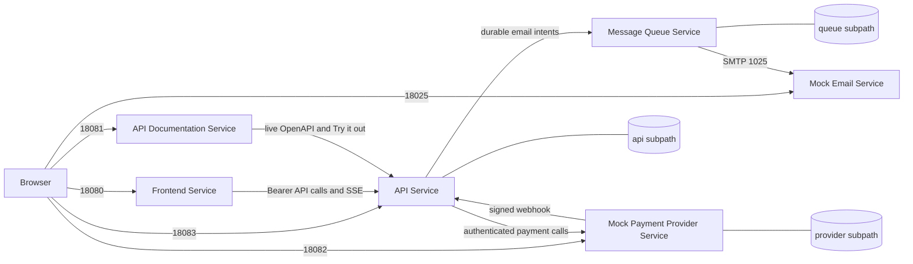

# ExecutivePros Payment Assessment

This repository contains a trusted, host-local payment assessment demo made up of six independently owned services. Start with [System_Architecture.md](System_Architecture.md); implementation contracts and their live checklists are in each service's `*_Implementation.md` and `*_Implementation_Todo.md` files.

> **Trusted demo only.** Seeded user and admin selection is passwordless, Swagger can mutate demo data, and Mailpit has no login. Keep every published port on loopback. Do not expose this stack to an untrusted network or use real customer or payment data.

## Architecture



The regular Compose services are exactly `api`, `frontend`, `queue`, `docs`, `mailpit`, and `provider`. API owns carts, payments, stock reservations, fulfilment, reconciliation and notification intents. The provider simulates checkout and sends signed events. Queue delivers email jobs to Mailpit over private SMTP. Frontend and docs are browser applications; docs fetches the live OpenAPI document directly from API. Each database service mounts only its own directory under the project-scoped `assessment_data` volume. Mailpit has a separate project-scoped volume.

## Prerequisites and clean-checkout setup

### Docker Desktop

Install Docker Desktop for your operating system using the official guide for [Windows](https://docs.docker.com/desktop/setup/install/windows-install/), [macOS](https://docs.docker.com/desktop/setup/install/mac-install/), or [Linux](https://docs.docker.com/desktop/setup/install/linux/). Start Docker Desktop and wait for the Engine to report that it is running before continuing.

### Docker Compose

Docker Desktop includes the Docker CLI, Engine, and Compose. This project requires Compose `v5.2.0` or newer for volume subpaths. Check the installed version:

```sh
docker compose version
```

If the version is older, update Docker Desktop and check again. On Linux systems using Docker Engine without Desktop, install the Compose CLI plugin by following [Docker's Linux instructions](https://docs.docker.com/compose/install/linux/). Avoid the legacy standalone Compose install.

### Node.js

Install Node.js `24.1.0` or newer from the official [Node.js download page](https://nodejs.org/en/download/). Use the installer for Windows or macOS; on Linux, use a supported package manager or the official platform binary. Verify the installation:

```sh
node --version
npm --version
```

### Yarn

The repository pins Yarn `4.18.0` in its `packageManager` field. Enable Corepack so it selects the repository's pinned version:

```sh
corepack enable
yarn --version
```

Run these commands from the repository root; `yarn --version` should print `4.18.0`. If your Node.js installation does not include Corepack, install it with `npm install --global corepack`, then run `corepack enable` again. See the [Yarn Corepack guide](https://yarnpkg.com/corepack) for platform-specific notes.

### Workspace and Docker storage

Keep at least 1 GiB free on the filesystem containing the repository. Image builds, service data, and cold backups need additional room. Check free space with `df -h .` on macOS/Linux, or in PowerShell with:

```powershell
Get-PSDrive -Name (Get-Location).Drive.Name
```

Also ensure Docker Desktop has enough storage available for the six service images and persistent demo volumes.

From the repository root:

```sh
yarn install --immutable
yarn deploy:local
yarn status
```

`deploy:local` creates `.env` from `.env.example` on first run, preserves it on later runs, generates three independent random service/HMAC secret files, writes their relative file paths into `.env`, then reads that environment file for the deployment. It checks versions, free space, image pins, origins, ports and rendered Compose config; builds the six images with live Docker layer progress; prepares project volume subpaths; runs API, provider, then queue initialization in removed one-shot containers; starts the six services; waits for health; and checks browser origins, API CORS/OpenAPI, and provider framing. It does not run down migrations.

To build an isolated test deployment and run the repository and service test gates, use:

```sh
yarn test:all
```

The command creates `.env.test` from `.env.test.example` when needed and appends any newly introduced defaults without replacing your existing test settings. It generates separate owner-only secrets under `.local/test-secrets/`, reads `.env.test`, verifies host and fixture port availability, and builds and starts all six services in a unique disposable Compose project. It waits for health and verifies the service origins before running root deployment tests, lint/format/typecheck/build checks, and the API, queue, provider, API Documentation, and Frontend unit, integration, contract, and end-to-end suites that each workspace defines. The frontend and documentation browser suites target the isolated test stack. On success, the command removes that test project's containers and volumes. If a gate fails, it removes the containers but retains that uniquely named project's volumes for diagnosis; the project name is printed in the output. The regular development project, `.env`, and its persistent data are not used by this command.

Secret values live only in ignored `.local/secrets/` files with owner-only access and are mounted into their service consumers. The first deployment generates all three automatically; repeated or concurrent deploys reuse the same values. `.env` stores only repository-relative secret file paths, which work on Windows, Linux, and macOS. POSIX hosts use directory mode `0700` and file mode `0600`; Windows uses `icacls` to remove inherited access and grant the current user access. Container secret paths stay `/run/secrets/...` on every host. If project data exists but a secret is missing, deployment stops and asks for the original secret to be restored. Never copy secret values into `.env`, browser config, URLs, logs, reports, or commits.

## Local endpoints

| Service       | Browser URL                        | Container endpoint                     | Notes                                                   |
| ------------- | ---------------------------------- | -------------------------------------- | ------------------------------------------------------- |
| Frontend      | `http://127.0.0.1:<FRONTEND_PORT>` | `frontend:8080`                        | Storefront and payment views                            |
| API docs      | `http://127.0.0.1:<DOCS_PORT>`     | `docs:8080`                            | Swagger UI; live OpenAPI comes from API                 |
| Mock provider | `http://127.0.0.1:<PROVIDER_PORT>` | `provider:3000`                        | Browser checkout and internal authenticated API         |
| API           | `http://127.0.0.1:<API_PORT>`      | `api:3000`                             | OpenAPI: `http://127.0.0.1:<API_PORT>/v1/api_docs.json` |
| Mailpit       | `http://127.0.0.1:<MAILPIT_PORT>`  | UI `mailpit:8025`; SMTP `mailpit:1025` | SMTP is private to Compose                              |
| Queue         | —                                  | `queue:3000`                           | Private HTTP; no published port                         |

Compose service names are for server-to-server traffic only. Browser configuration uses loopback origins derived by Compose from the five host port variables in `.env` (`FRONTEND_PORT`, `DOCS_PORT`, `PROVIDER_PORT`, `API_PORT`, and `MAILPIT_PORT`). When assigning alternate ports, change only those port values. Deployment preflight rejects duplicate or low host ports and verifies every derived origin against the corresponding published port.

## Operations

```sh
yarn deploy:local
yarn status
docker compose --project-name executivepros_assessment --env-file .env --file compose.yaml logs --tail=100
yarn stop
yarn deploy:local       # resume using the same persistent data and secrets
yarn backup             # cold backup; services remain stopped
```

`stop` preserves containers and volumes. `backup` stops writers, archives the entire shared database volume and Mailpit volume, checks archive readability, and writes a manifest with source volume identities, image IDs, secret fingerprints and archive checksums. Secret files are not included. Restore requires the same secret files and a new disposable project name:

Mailpit retains captured messages and does not prune by age or count. During the demo, inspect inbox growth in its UI and check Docker storage with `docker system df -v`; each message is limited to 1 MB. Take the cold backup before upgrading or resetting a Mailpit volume.

```sh
yarn restore path/to/verified-backup-directory \
  --project e2e-restore --confirm-project e2e-restore
yarn deploy:local --project e2e-restore --env-file .local/restore.env
```

Restore creates new project volumes, verifies checksums and SQLite integrity, and does not start services. Review the candidate project's origins and verify its health before directing a browser to it. The command never overwrites an existing target volume.

The only volume-deleting operation is explicitly confirmed `db:down`, intended for a disposable project such as `e2e-assessment`:

```sh
yarn db:down --project e2e-assessment --confirm-project e2e-assessment
```

The project name must start with `test-`, `e2e-`, or `disposable-`, and confirmation must match exactly. Do not run it against the developer project. There are no deployment-time or production down migrations; rollback preserves database files/logs and uses a schema-compatible image or a verified restore into new volumes.

## Payment walkthrough

1. Open the frontend, select a seeded user (or the seeded admin in this trusted demo), and inspect the API-provided products and stock.
2. Add products and quantities to the cart. The API calculates the total and reserves stock.
3. Optionally select a provider failure scenario, then check out. The client sends a new `Idempotency-Key` and stores it before the request.
4. Complete **Pay successfully**, **Fail payment**, or **Cancel payment** in the provider iframe. If framing fails, use the frontend's new-tab fallback.
5. Return to the frontend. Its displayed payment status comes from a fresh API read; provider `postMessage` and SSE are hints. Inspect payment details, fulfilment, stock and notification status.
6. Open Mailpit to inspect queued email and API docs to exercise the live contract. Mailpit records delivered messages; a queue acknowledgement means job acceptance, not proof of SMTP delivery.

Reuse the same key after a timeout or uncertain response because the server may have accepted the request. Use a new key for a new attempt only after the API confirms failure/cancellation. Provider webhook loss is reconciled through authenticated provider status lookup. Queue retries may duplicate an email while preserving one API notification intent and one fulfilment. At day-30 expiry, a provider-reported pending payment becomes terminally failed without provider cancellation; a later provider success is recorded as a discrepancy for admin review. There is intentionally no client PUT/PATCH payment-status endpoint: only provider-authenticated webhook and reconciliation evidence updates payment state.

## Test commands

Each implementation checklist is authoritative; an unrun or unchecked test remains incomplete.

```sh
# API, queue and provider use Japa v5 suites provisioned from bin/test.ts.
yarn workspace @executivepros/api lint
yarn workspace @executivepros/api typecheck
yarn workspace @executivepros/api test
yarn workspace @executivepros/queue lint
yarn workspace @executivepros/queue typecheck
yarn workspace @executivepros/queue test
yarn workspace @executivepros/provider lint
yarn workspace @executivepros/provider typecheck
yarn workspace @executivepros/provider test

yarn workspace @executivepros/frontend lint
yarn workspace @executivepros/frontend typecheck
yarn workspace @executivepros/frontend test:unit
yarn workspace @executivepros/frontend test:integration
yarn workspace @executivepros/frontend build
FRONTEND_TEST_URL=http://127.0.0.1:<isolated-frontend-port> yarn workspace @executivepros/frontend test:e2e

yarn workspace @executivepros/api-docs lint
yarn workspace @executivepros/api-docs typecheck
yarn workspace @executivepros/api-docs test:unit
yarn workspace @executivepros/api-docs test:integration
yarn workspace @executivepros/api-docs build
DOCS_TEST_URL=http://127.0.0.1:<isolated-docs-port> \
API_ORIGIN_TEST=http://127.0.0.1:<isolated-api-port> \
PROVIDER_ORIGIN_TEST=http://127.0.0.1:<isolated-provider-port> \
yarn workspace @executivepros/api-docs test:e2e

yarn test:deployment
```

For the root Compose smoke, make a nonsecret env file from `.env.example` and assign a unique unused loopback port to each `*_PORT` variable (all at least `10000`). Compose derives the matching public origins automatically. Then run:

```sh
yarn deploy:local --project e2e-assessment --env-file .local/e2e-assessment.env
FRONTEND_TEST_URL=http://127.0.0.1:<frontend-port> yarn workspace @executivepros/frontend test:e2e
DOCS_TEST_URL=http://127.0.0.1:<docs-port> \
API_ORIGIN_TEST=http://127.0.0.1:<api-port> \
PROVIDER_ORIGIN_TEST=http://127.0.0.1:<provider-port> \
LIVE_API_ORIGIN=http://127.0.0.1:<api-port> \
yarn workspace @executivepros/api-docs test:e2e
yarn stop --project e2e-assessment --env-file .local/e2e-assessment.env
```

The project uses separate named volumes. Remove them only after review with `yarn db:down --project e2e-assessment --confirm-project e2e-assessment`.

The API e2e suite starts independent provider/queue services and a disposable Mailpit container; it needs Docker. Mailpit is validated using its pinned source-built image, HTTP readiness/API, and real SMTP messages. All browser/integration tests that mutate payments must use a unique Compose project, separate volumes and unused loopback ports. Never target the default demo data with a test suite.
