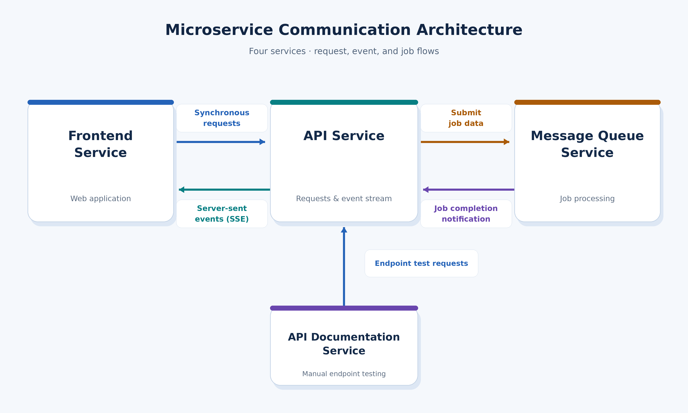

# System Architecture / Design Document

## Author: Ndianabasi Udonkang (Senior Software Engineer)

## Email: ndianabasi.udonkang@gmail.com

In partial fulfillment of the ExecutivePro Assessment for Node.js + React Developer Role

## Summary

This system architecture document is focused on the design of a Node.js microservice which safely and reliably handles payment processing requests and provides interfaces for authorised users to review payments.

Four microservices are proposed within this architecture:

1. API Service,
2. Frontend Service,
3. Message Queue Service,
4. API Documentation Service,
5. Mock Email Service, and
6. Mock Payment Provider Service

### 1. API Service

The API service is the main application backend. It will be developed with TypeScript for the Nodejs runtime. The API Service will domicile all proposed endpoints to be called from the Frontend Service and will provide authentication, authorisation, and security for all API requests.

### 2. Frontend Service

The Frontend Service will provide the user interface for interacting with the API service and receiving real-time events from the API service.

### 3. Message Queue Service

The Message Queue Service will provide an asynchronous messaging queue which the API Service can publish jobs to for asynchronous processing.

### 4. API Documentation Service

The API Documentation Service will provide an user interface to exploring the functionalities of the endpoints exposed by the API service.

### 5. Mock Payment Provider Service

The Mock Payment Provider Service will be used to simulate a real payment provider. The Mock Payment Provider will emit webhook events to the API Service. The API Service is expected to handle the different events robustly. The webhook event data will be simplified.

### 6. Mock Email Service

The Mock Email Service will be used to delivery email to interested parties within the system. It will have its own port. The Frontend Service is expected to provide a simple, global interface element for accessing the Mock Email Service within its own interface.

## Reference-Level Explanations

### Architecture / Workflow Overview

The flowchart below presents the relationship between the four (4) proposed microservices. Details of each microservice will be discussed in sections below.

### Database and Data Models

#### Database Engine

The SQLite database engine will be used for file-based data persistence. In-memory or JSON file persistence recommended in the brief will not be used due the data persistence requirements of the API and Message Queue Services. SQLite meets the simplicity requirements as we are not spawning a full-blown database server like PostgreSQL.

#### Data Models

The following databases and tables will be needed for the operations to be performed by the 4 microservices.

##### Database and Tables Managed by the API Service

Below is a proposed relational database schema for `api.db`, using **SQLite-compatible data types** and constraints.

The schema includes the four requested tables, plus a `cart_items` table to support carts containing multiple products.

###### 1.`api.db / users`

The `users` table stores basic information about users who are authenticated or authorised to perform API operations.

| Name         | Data Type | Constraints                                                   | Description                                                      |
| ------------ | --------- | ------------------------------------------------------------- | ---------------------------------------------------------------- |
| `id`         | INTEGER   | PRIMARY KEY, AUTOINCREMENT                                    | Unique identifier for each user.                                 |
| `first_name` | TEXT      | NOT NULL                                                      | User's first name.                                               |
| `last_name`  | TEXT      | NOT NULL                                                      | User's last name.                                                |
| `email`      | TEXT      | NOT NULL, UNIQUE                                              | User's email address, used for authentication and communication. |
| `role`       | TEXT      | NOT NULL, DEFAULT 'user', CHECK (`role IN ('user', 'admin')`) | Determines the user's authorisation level.                       |
| `is_active`  | INTEGER   | NOT NULL, DEFAULT 1, CHECK (`is_active IN (0, 1)`)            | Indicates whether the user's account is active.                  |
| `created_at` | TEXT      | NOT NULL, DEFAULT CURRENT_TIMESTAMP                           | Timestamp when the user account was created.                     |
| `updated_at` | TEXT      | NOT NULL, DEFAULT CURRENT_TIMESTAMP                           | Timestamp when the user account was last updated.                |

###### 2.`api.db / payments`

The `payments` table stores simplified information about payments initiated by users. Each payment references the cart being checked out.

| Name                 | Data Type | Constraints                                                                                    | Description                                                          |
| -------------------- | --------- | ---------------------------------------------------------------------------------------------- | -------------------------------------------------------------------- |
| `id`                 | INTEGER   | PRIMARY KEY, AUTOINCREMENT                                                                     | Unique identifier for each payment.                                  |
| `user_id`            | INTEGER   | NOT NULL, FOREIGN KEY -> `users(id)`                                                           | Identifies the user who initiated the payment.                       |
| `cart_id`            | INTEGER   | NOT NULL, FOREIGN KEY -> `carts(id)`                                                           | Identifies the cart associated with the payment.                     |
| `reference`          | TEXT      | NOT NULL, UNIQUE                                                                               | Unique payment reference used for tracking transactions.             |
| `amount`             | INTEGER   | NOT NULL, CHECK (`amount >= 0`)                                                                | Total payment amount in the currency's smallest unit (e.g., kobo).   |
| `currency`           | TEXT      | NOT NULL, DEFAULT 'NGN'                                                                        | ISO 4217 currency code associated with the payment.                  |
| `status`             | TEXT      | NOT NULL, DEFAULT 'pending', CHECK (`status IN ('pending', 'success', 'failed', 'cancelled')`) | Current status of the payment.                                       |
| `provider`           | TEXT      | NULL                                                                                           | Payment service provider responsible for processing the transaction. |
| `provider_reference` | TEXT      | NULL, UNIQUE                                                                                   | Transaction reference returned by the payment provider.              |
| `paid_at`            | TEXT      | NULL                                                                                           | Timestamp when the payment was successfully completed.               |
| `created_at`         | TEXT      | NOT NULL, DEFAULT CURRENT_TIMESTAMP                                                            | Timestamp when the payment record was created.                       |
| `updated_at`         | TEXT      | NOT NULL, DEFAULT CURRENT_TIMESTAMP                                                            | Timestamp when the payment record was last updated.                  |

###### 3.`api.db / products`

The `products` table stores simplified information about products available for users to purchase.

| Name             | Data Type | Constraints                                        | Description                                                 |
| ---------------- | --------- | -------------------------------------------------- | ----------------------------------------------------------- |
| `id`             | INTEGER   | PRIMARY KEY, AUTOINCREMENT                         | Unique identifier for each product.                         |
| `name`           | TEXT      | NOT NULL                                           | Name of the product.                                        |
| `description`    | TEXT      | NULL                                               | Detailed description of the product.                        |
| `sku`            | TEXT      | NOT NULL, UNIQUE                                   | Stock Keeping Unit used to uniquely identify a product.     |
| `price`          | INTEGER   | NOT NULL, CHECK (`price >= 0`)                     | Unit price of the product in the currency's smallest unit.  |
| `currency`       | TEXT      | NOT NULL, DEFAULT 'NGN'                            | ISO 4217 currency code associated with the product's price. |
| `stock_quantity` | INTEGER   | NOT NULL, DEFAULT 0, CHECK (`stock_quantity >= 0`) | Number of units currently available for purchase.           |
| `is_active`      | INTEGER   | NOT NULL, DEFAULT 1, CHECK (`is_active IN (0, 1)`) | Indicates whether the product is available for purchase.    |
| `created_at`     | TEXT      | NOT NULL, DEFAULT CURRENT_TIMESTAMP                | Timestamp when the product was created.                     |
| `updated_at`     | TEXT      | NOT NULL, DEFAULT CURRENT_TIMESTAMP                | Timestamp when the product was last updated.                |

###### 4.`api.db / carts`

The `carts` table stores information about shopping carts created by users. Each cart contains one or more products when checked out and can be associated with a payment.

| Name             | Data Type | Constraints                                                                            | Description                                                       |
| ---------------- | --------- | -------------------------------------------------------------------------------------- | ----------------------------------------------------------------- |
| `id`             | INTEGER   | PRIMARY KEY, AUTOINCREMENT                                                             | Unique identifier for each cart.                                  |
| `user_id`        | INTEGER   | NOT NULL, FOREIGN KEY -> `users(id)`                                                   | Identifies the user who owns the cart.                            |
| `status`         | TEXT      | NOT NULL, DEFAULT 'active', CHECK (`status IN ('active', 'checked_out', 'abandoned')`) | Current lifecycle status of the cart.                             |
| `currency`       | TEXT      | NOT NULL, DEFAULT 'NGN'                                                                | ISO 4217 currency code used for the cart.                         |
| `total_amount`   | INTEGER   | NOT NULL, DEFAULT 0, CHECK (`total_amount >= 0`)                                       | Total monetary value of the cart in the currency's smallest unit. |
| `checked_out_at` | TEXT      | NULL                                                                                   | Timestamp when the user checked out the cart.                     |
| `created_at`     | TEXT      | NOT NULL, DEFAULT CURRENT_TIMESTAMP                                                    | Timestamp when the cart was created.                              |
| `updated_at`     | TEXT      | NOT NULL, DEFAULT CURRENT_TIMESTAMP                                                    | Timestamp when the cart was last updated.                         |

###### 5.`api.db / cart_items`

The `cart_items` table establishes the many-to-many relationship between carts and products. It allows a single cart to contain multiple products, and the same product to appear in multiple carts.

| Name         | Data Type | Constraints                                            | Description                                                                           |
| ------------ | --------- | ------------------------------------------------------ | ------------------------------------------------------------------------------------- |
| `id`         | INTEGER   | PRIMARY KEY, AUTOINCREMENT                             | Unique identifier for each cart item.                                                 |
| `cart_id`    | INTEGER   | NOT NULL, FOREIGN KEY -> `carts(id)` ON DELETE CASCADE | Identifies the cart containing the product.                                           |
| `product_id` | INTEGER   | NOT NULL, FOREIGN KEY -> `products(id)`                | Identifies the product added to the cart.                                             |
| `quantity`   | INTEGER   | NOT NULL, DEFAULT 1, CHECK (`quantity > 0`)            | Number of units of the product in the cart.                                           |
| `unit_price` | INTEGER   | NOT NULL, CHECK (`unit_price >= 0`)                    | Snapshot of the product's unit price when added to the cart or finalised at checkout. |
| `created_at` | TEXT      | NOT NULL, DEFAULT CURRENT_TIMESTAMP                    | Timestamp when the product was added to the cart.                                     |
| `updated_at` | TEXT      | NOT NULL, DEFAULT CURRENT_TIMESTAMP                    | Timestamp when the cart item was last updated.                                        |

**Additional table-level constraint:** `UNIQUE (cart_id, product_id)` prevents the same product from appearing in multiple rows within a single cart.

## 6.`api.db / user_tokens`

The `user_tokens` table stores opaque authentication tokens associated with users. Each user can have multiple tokens, allowing authentication across different sessions or devices.

| Name           | Data Type | Constraints                                           | Description                                                                          |
| -------------- | --------- | ----------------------------------------------------- | ------------------------------------------------------------------------------------ |
| `id`           | INTEGER   | PRIMARY KEY, AUTOINCREMENT                            | Unique identifier for each token record.                                             |
| `user_id`      | INTEGER   | NOT NULL, FOREIGN KEY → `users(id)` ON DELETE CASCADE | Identifies the user who owns the token.                                              |
| `token_hash`   | TEXT      | NOT NULL, UNIQUE                                      | Cryptographic hash of the opaque authentication token.                               |
| `expires_at`   | TEXT      | NOT NULL                                              | Timestamp after which the token is no longer valid.                                  |
| `revoked_at`   | TEXT      | NULL                                                  | Timestamp when the token was revoked. NULL indicates the token has not been revoked. |
| `created_at`   | TEXT      | NOT NULL, DEFAULT CURRENT_TIMESTAMP                   | Timestamp when the token was generated.                                              |
| `last_used_at` | TEXT      | NULL                                                  | Timestamp when the token was last used for authentication.                           |

###### 7. Database relationships

Simplified entity relationship diagram. N = many.

The schema supports these relationships:

- **Users -> Carts:** One user can own multiple carts.
- **Users -> Payments:** One user can initiate multiple payments.
- **Carts -> Payments:** One cart can have multiple payment attempts.
- **Carts -> Cart Items:** One cart can contain multiple cart items.
- **Products -> Cart Items:** One product can appear in multiple carts.
- **Users -> User Tokens:** One user can log in multiple times.

##### Database to be Managed by the Message Queue Service

###### 1. `jobs.db` Database

The tables within the `jobs.db` database will be managed internally by the Message Queue Service, and as such, will not be discussed here.

### API Service Design

#### Required Endpoints

The following endpoints are required:

1. `POST /v1/login`

Logs an existing user in without a password.

2. `GET /v1/products`

Fetches all seeded products (with optional pagination). There will be no endpoint for creating products and no endpoint for fetching a single product.

3. `POST /v1/cart`

Creates a cart (if no active cart exists) and adds the accompanied products to the cart. A user will have only one active cart at a time. An active cart is one which is not checked out yet.

3. `POST /v1/cart/checkout`

Checks out an active cart and initialises the payment flow for the cart.

4. `POST /v1/webhooks/payment`

A webhook event endpoint used by the Mock Payment Provider to notify the API Service of an incoming payment.

5. `GET /v1/payments/:payment_id`

Fetches the complete details of a payment including associated resources.

Access Level: Admin

** NOTE : ** There will be no endpoint for manually updating a payment status. Such an endpoint will be a security flaw. Payment statuses can only be updated during webhook handling or via a CRON job which marks payments which has been in pending state for more 30 days as failed payments.

#### Payment Flow

The payment flow begins with the checkout of an active cart from the Frontend Service or API Documentation Service (client). The checkout process initialises the payment. During payment intialisation:

1. The API service records the initialised payment,
2. The API service calls the Mock Payment Provider with the total amount and payment reference,
3. The Mock Payment Provider returns the payment URL to the API service,
4. The API service proxies the payment URL to the client.
5. The client visits the payment URL and requires the user to complete the payment.
6. The Mock Payment Provider receives the completed payment.
7. The Mock Payment Provider calls the API service with the details of the completed payment.
8. The API Service verifies the payment details in the webhook event.
9. If payment is verified, the API service grants value to the user and notifies the Frontend Service via server-sent event. Emails should also be sent to all interested parties.
10. If payment processing fails, the API service notifies the Frontend Service via server-sent event. Emails should also be sent to all interested parties.

In order to simulate failure cases, the Frontend Service is expected to integrate a integrate a list of failure scenarios to be generated. The selected scenario will be sent with the cart checkout request to the API service. Any scenario which involves the Mock Payment Provider will be forwarded to the Mock Payment Provider during the payment initialisation. The Mock Payment Provider is expected to simulate that failure mode during its webhook event submission to the API Service.

Such failure scenarios include (but not limited to):

1. Simultaneous double checkout of a cart.
2. Frontend Service client timeout and checkout retry.
3. Mock Payment Provider connection timeout.
4. Mock Payment Provider response lost.
5. Simultaneous duplicate webhooks from Mock API service.
6. Conflicting webhook events from Mock Payment Provider.
7. Incorrect payment amount from Mock Payment Provider.
8. Invalid webhook signature from Mock Payment Provider.
9. Crash within API service after granting value.
10. SSE client disconnected.

#### Authentication for Endpoints

#### Access Control for Endpoints

##### User and Roles Management

This architecture is not focused on user or access control managements. Users will be seeded and assigned to roles during seeding. There will be no password-based login from the Frontend Service. Rather, a dropdown list of seeded users will be displayed for the user to choose and login with. The role of user should be displayed against the user on the Frontend Service.

#### Security for Endpoints

#### Transport Mechanisms Between API Service and Frontend Service

- Synchronous API Requests
- Asynchronous Server-Sent Events

#### State and Integrity Logic

#### Failure and Idempotency Analysis

##### Duplicate Payment or Webhook Events

##### Retry Handling

### Message Queue Service Design

### Frontend Service Design

### API Documentation Service Design

### Mock Payment Provider Design

### Miscellaneous Designs

#### Logging Service

#### Global Error Handling

### Test Gates

#### API Service Test Gate

#### Frontend Service Test Gate

### Deployment

### API Documentation

### Alternatives

### Drawbacks

### Prior Art

### Parts of the System Affected
